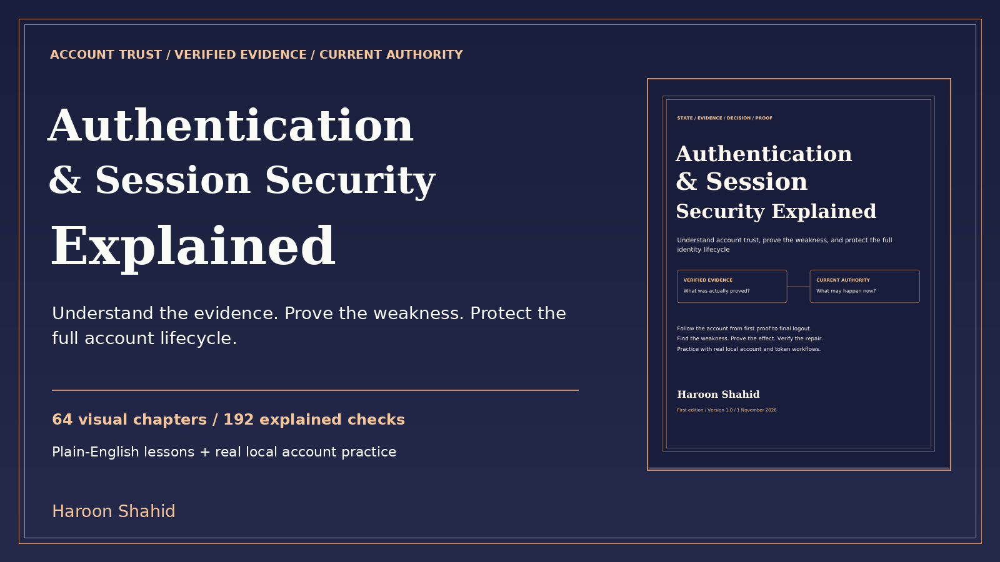

# Authentication & Session Security Explained - free preview

A visual learning kit by **Haroon Shahid** about account evidence, current authority and secure identity lifecycles.

[Read the free preview](Authentication_and_Session_Security_Explained_Free_Preview.pdf)

The sample includes the introduction, learning roadmap and Chapters 1-3: the account journey, browser/server requests, and cookie/session foundations.

## Complete learning kit
- 64 chapters; a linked 188-page PDF and responsive offline HTML.
- 128 chapter/revision diagrams, 16 extra flow models and a dependency map.
- 192 explained checks; 48 predictions; 36 guided missions; 28 worked cases.
- Identity Harbor: real local password hashing, TOTP, session state, recovery grants, JWT checks and refresh rotation.
- Credential/evidence worksheets, contract atlas, reporting/regression tools, glossary, linked index and primary sources.

[Get the complete ebook and practice kit](https://haroonshahid.gumroad.com/l/authentication-and-session-security-explained)

The optional lab needs Python 3.11+, a browser and local port 8960. No third-party packages are required. Fixtures are privileged teaching controls. WebAuthn, providers, real message delivery, frameworks and distributed deployments need their own integration tests. This is education, not certification or a guarantee of results.

The paid manuscript and lab are not part of this public sample. The free preview may be shared unchanged with attribution.
