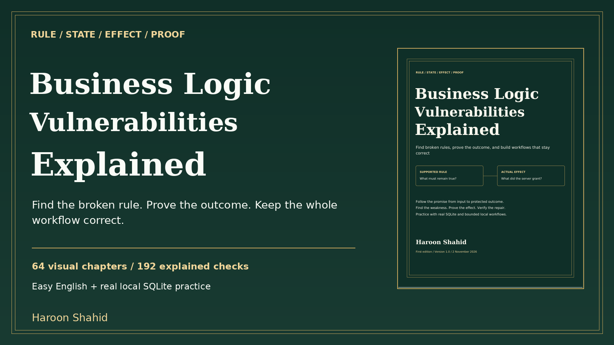

# Business Logic Vulnerabilities Explained - free preview

A visual learning kit by **Haroon Shahid** about application rules, state, protected outcomes and defensible evidence.

[Read the free preview](Business_Logic_Vulnerabilities_Explained_Free_Preview.pdf)

The sample includes the introduction, learning roadmap and Chapters 1-3: feature promises, browser/server requests, and identity/permission/workflow boundaries.

## Complete learning kit
- 64 chapters; a linked 193-page PDF and responsive offline HTML.
- 128 chapter/revision diagrams, 20 extra decision models and a dependency map.
- 192 explained checks; 56 predictions; 40 guided missions; 32 worked cases.
- RuleForge: actual SQLite transactions, constraints, local HMAC event verification, competing HTTP calls and dummy protected effects.
- Rule/evidence worksheets, contract atlas, reporting/regression tools, glossary, linked index and primary sources.

The full ebook and practice kit will be available on Gumroad after launch.

The optional lab needs Python 3.11+ with sqlite3, a browser and local port 8970. No third-party package installation is required. All value and effects are fictional. Fixtures are privileged teaching controls. Real providers, frameworks, inventory, subscriptions and distributed deployments need their own integration tests. This is education, not certification or a guarantee of results.

The paid manuscript and lab are not included in this public sample. The preview may be shared unchanged with attribution.
