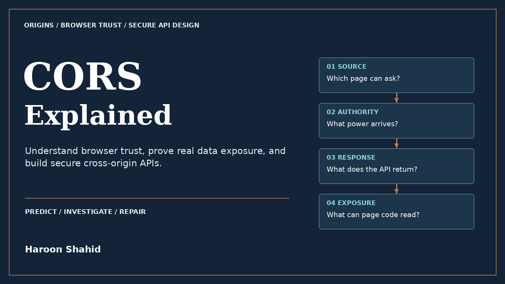

# CORS Explained — Free preview

By Haroon Shahid.

A request being sent is different from a response being readable. This visual ebook teaches the browser model behind that distinction, from web foundations to evidence-based CORS investigation and secure API design.

[Read the free introduction and first three chapters](CORS_Explained_Free_Preview.pdf).

The full kit includes 59 chapters, 112 original chapter diagrams, 177 answered knowledge checks, prediction exercises, worked review cases, and a local fictional practice lab. It explains public-sharing non-findings as well as private reflection, wrong-port matches, null origins, token chains, preflight caching, and secure repairs.

[Get the full ebook and local learning kit](GUMROAD_PRODUCT_URL).

The book reads offline. The optional local lab needs Node 24+ and a desktop browser. Its Validation Report states the tested engine and distinguishes executed local examples from reviewed framework and cloud guidance.

This repository contains only the unchanged free preview and promotional cover. It does not contain the paid book or customer package. The preview may be shared unchanged with attribution. Use security learning only on systems you own or are authorized to assess.
