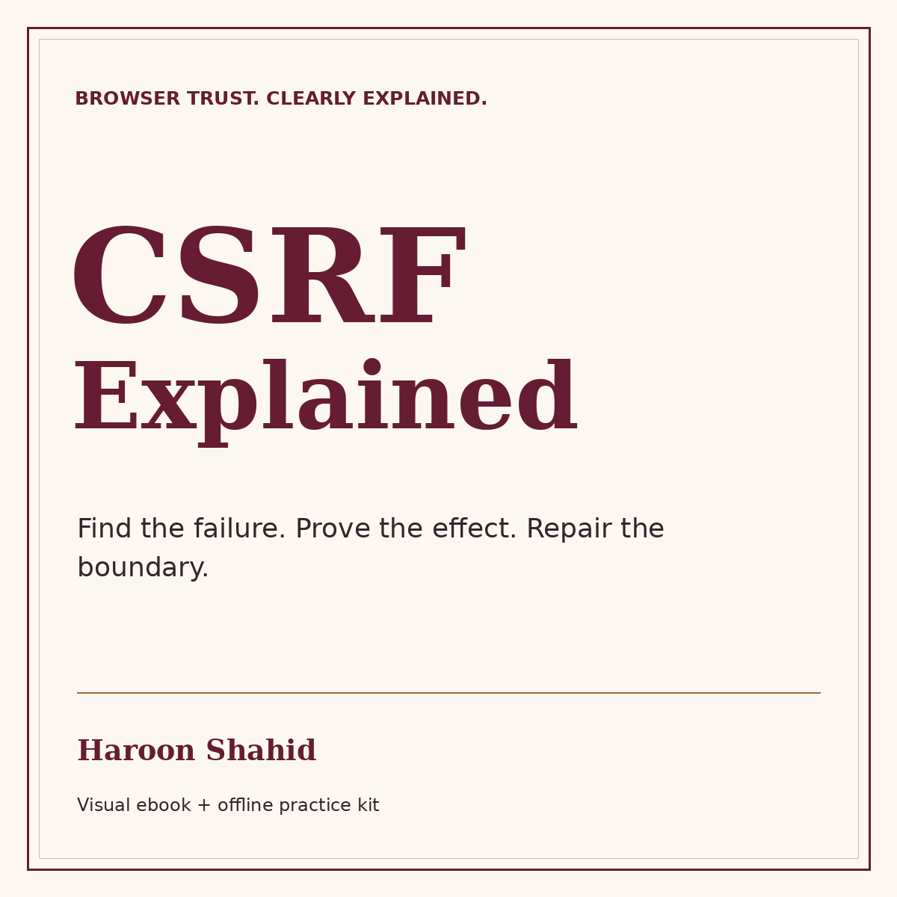

# CSRF Explained - free preview

A visual guide from browser basics to finding, proving, and preventing request forgery, by Haroon Shahid.

[Read the free preview](CSRF_Explained_Free_Preview.pdf): introduction, learning roadmap, and the first three chapters.

[Get the full ebook and learning kit](REPLACE_WITH_YOUR_NEW_CSRF_GUMROAD_URL).

The full package includes 48 chapters, 83 teaching figures, 144 answered checks, offline reading, local lab missions, worked review cases, and revision resources. The practice lab uses fictional accounts on fixed loopback addresses and requires Node.js 24+.

The preview may be shared unchanged with attribution. This repository contains the public sample; the paid publication has a separate license.
