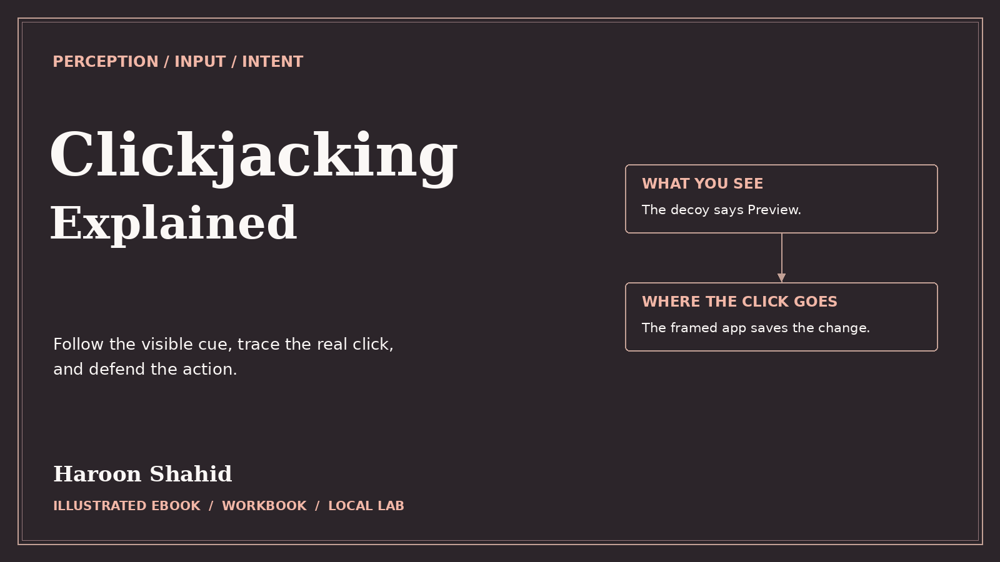

# Clickjacking Explained — Free Preview

See where a click actually lands, then test the browser policies that protect real actions.

## Read the free sample

The 14-page preview includes the introduction, learning roadmap, and first three chapters.

- [Open the preview PDF](./Clickjacking_Explained_Free_Preview.pdf)
- [Offline HTML sample](./Clickjacking_Explained_Free_Preview.html): select **Download raw file**, then open it in your browser.

## Get the full learning kit

The full edition includes a 101-page PDF with 36 chapters, an offline HTML reading edition, exercises, and **Framewright Lab** for optional local practice.

[Get Clickjacking Explained on Gumroad](https://haroonshahid.gumroad.com/l/clickjacking-explained)

Written by Haroon Shahid. For questions or corrections, email [gaknt2@gmail.com](mailto:gaknt2@gmail.com). [See all free previews](../README.md).
