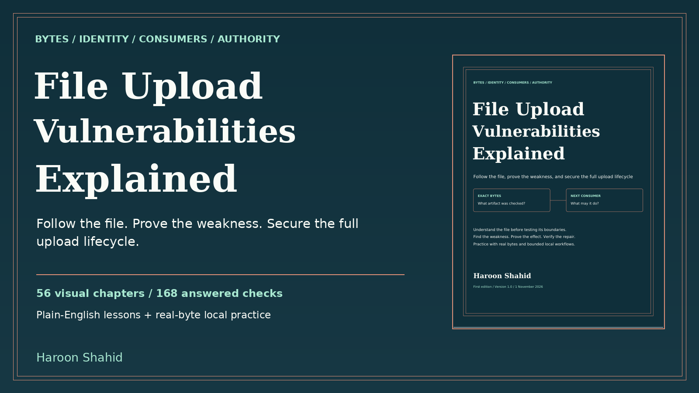

# File Upload Vulnerabilities Explained — free preview

What happens to a file after the Upload button says success? This visual guide by **Haroon Shahid** follows a file from the browser through validation, storage, scanning, and delivery.

[Read the free PDF preview](File_Upload_Vulnerabilities_Explained_Free_Preview.pdf). It includes the introduction, learning roadmap, and first three chapters.

## Complete learning kit

- A linked 164-page PDF and an offline HTML edition.
- 56 chapters and 168 knowledge checks with explained answers.
- 40 prediction exercises, 32 guided local missions, and 24 worked review cases.
- DocDock, a local Python lab with real file uploads and examples of quarantine, private reads, and signed links.

[Get the complete ebook and practice kit on Gumroad](https://haroonshahid.gumroad.com/l/file-upload-vulnerabilities-explained).

The PDF and HTML can be read offline. The optional lab needs Python 3.11 or later, a browser, and free local ports 8950 and 8951. It uses fictional files and accounts.

The paid ebook and lab are separate from this public sample. The free preview may be shared unchanged with attribution. For help or corrections, email [gaknt2@gmail.com](mailto:gaknt2@gmail.com).
