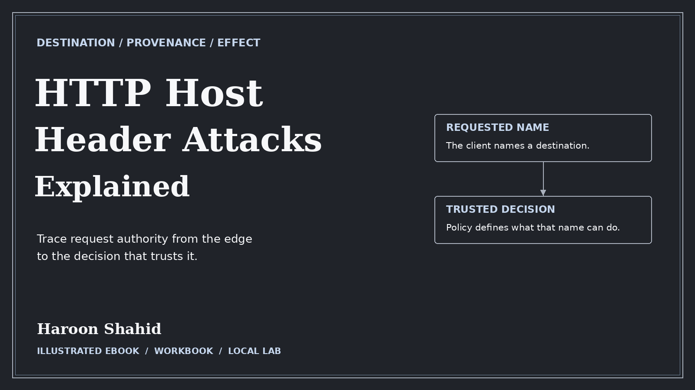

# HTTP Host Header Attacks Explained — Free Preview

Trace which hostname a proxy, cache, or application trusts and verify the effect on routing and reset links.

## Read the free sample

The 14-page preview includes the introduction, learning roadmap, and first three chapters.

- [Open the preview PDF](./HTTP_Host_Header_Attacks_Explained_Free_Preview.pdf)
- [Offline HTML sample](./HTTP_Host_Header_Attacks_Explained_Free_Preview.html): select **Download raw file**, then open it in your browser.

## Get the full learning kit

The full edition includes a 105-page PDF with 36 chapters, an offline HTML reading edition, exercises, and **Authority Yard** for optional local practice.

The full edition is awaiting release. [Browse the available ebooks on Gumroad](https://haroonshahid.gumroad.com).

Written by Haroon Shahid. For questions or corrections, email [gaknt2@gmail.com](mailto:gaknt2@gmail.com). [See all free previews](../README.md).
