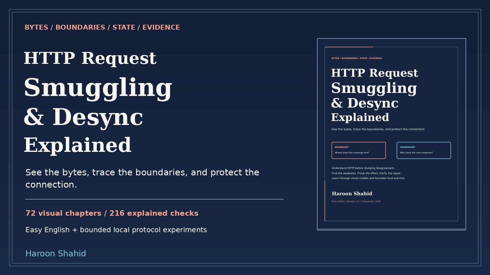

# HTTP Request Smuggling & Desync Explained — free preview

A visual learning kit by **Haroon Shahid** about HTTP message boundaries, parser disagreement, connection state and verified repair.

[Read the free preview](HTTP_Request_Smuggling_and_Desync_Explained_Free_Preview.pdf)

The sample includes the introduction, roadmap and Chapters 1-3: protocols and authority, TCP streams, and HTTP semantics/versions. No prior security knowledge is assumed.

## Complete learning kit

- 215-page linked PDF and offline HTML, with 72 illustrated chapters.
- 216 explained chapter checks and 169 original SVG visual assets.
- 64 predictions, 40 local missions and 36 worked synthetic cases.
- Optional Python standard-library workshop with finite H1 models, real loopback byte transport, a native response bench and explicit translation/lifecycle simulations.
- Hop passport, evidence/report worksheets, recipes, contract atlas, glossary, primary-source catalog and linked index.

[Get the full ebook and practice kit](https://haroonshahid.gumroad.com/l/http-request-smuggling-and-desync-explained)

The lab needs a supported Python 3 release compatible with Python 3.11+, a browser and free local port 8995. Socket mode also opens a temporary loopback port. No third-party packages or public target are required. Models are not production proxy implementations or CVE reproductions. Native H2/H3, real pooling, browser exploit delivery, clouds and cache/multi-user impact require actual integration/deployment validation. The included Validation Report states executed checks and limits.

The unchanged preview may be shared with attribution. Education only; no certification or results guarantee. For help or corrections, email gaknt2@gmail.com.
