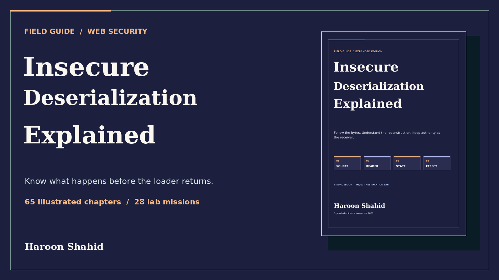

# Insecure Deserialization Explained

Follow the bytes. Understand the reconstruction. Keep authority at the receiver.

[Read the free preview](Insecure_Deserialization_Explained_Expanded_Free_Preview.pdf): introduction and Chapters 1–3.

The complete guide includes 113 pages, 65 chapters, 155 explained checks, 14 worked traces and 28 local scenarios with comparisons.

The full ebook and practice kit will be available on Gumroad after launch.

By Haroon Shahid. Unchanged preview may be shared with attribution.
