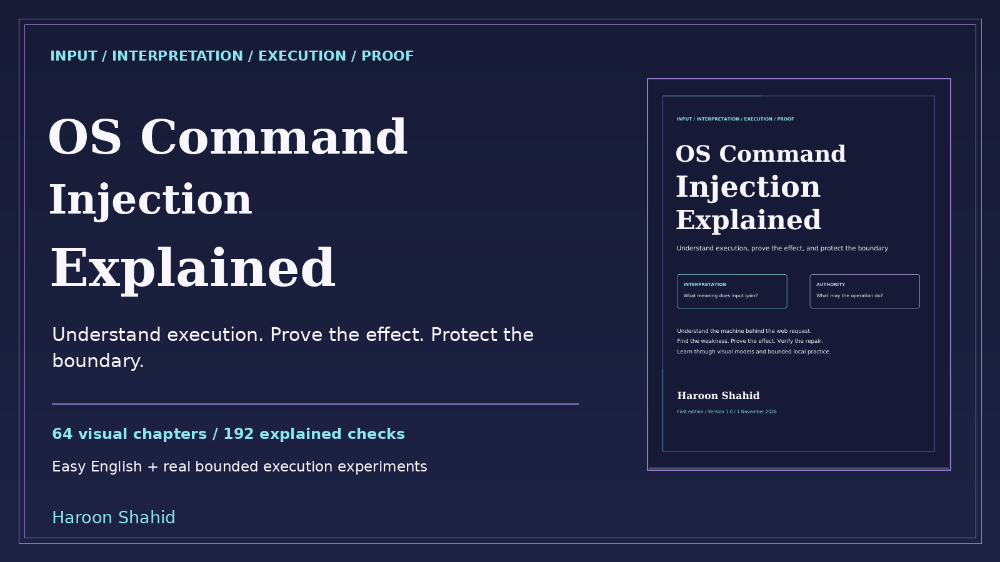

# OS Command Injection Explained - free preview

A visual learning kit by **Haroon Shahid** about how input reaches interpreters, programs and operating-system authority.

[Read the free preview](OS_Command_Injection_Explained_Free_Preview.pdf)

The sample contains the introduction, roadmap and Chapters 1-3: the computer behind the website, programs and processes, and the web-to-worker data flow.

## Complete learning kit
- 195-page linked PDF and offline HTML, with 64 illustrated chapters.
- 192 explained knowledge checks and 149 original SVG visual assets.
- 56 predictions, 40 guided local missions and 32 worked synthetic cases.
- Optional ExecScope Python lab, execution passport, evidence/report templates, recipes, contract atlas, glossary, sources and linked index.

The full ebook and practice kit will be available on Gumroad after launch.

The lab needs Python 3.11+ and free local ports 8981-8982. POSIX shell/PATH experiments need /bin/sh. It uses finite original helper samples, dummy data and fixed loopback callbacks, not a general command console or arbitrary-code sandbox. Native Windows shells and other deployment integrations are review guidance. This is education, not certification or a guarantee of results.

The paid publication, lab and publisher sources are not included in this public preview. The preview may be shared unchanged with attribution. For help or corrections, email gaknt19@gmail.com.
