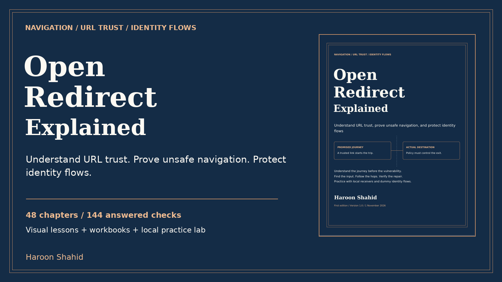

# Open Redirect Explained - free preview

A visual guide by **Haroon Shahid** to URL trust, controlled proof of unsafe navigation, and safer identity flows.

[Read the free preview](Open_Redirect_Explained_Free_Preview.pdf)

The sample includes the introduction, learning roadmap and Chapters 1-3. It starts with trust, web requests and URL anatomy.

## Full learning kit

- 48 chapters; linked PDF and responsive offline HTML.
- 96 chapter/revision diagrams, 12 additional flow models and a dependency map.
- 144 answered checks, 40 predictions, 32 guided missions and 24 review cases.
- Fixed-local Node.js practice with dummy data and selected code/state/PKCE checks.
- Evidence, reporting, regression and mastery templates; glossary, index and primary references.

[Get the complete ebook and practice kit](REPLACE_WITH_GUMROAD_URL)

The paid manuscript and lab are not in this repository. The preview may be shared unchanged with attribution. Practice only on systems you own or are explicitly authorized to assess.

The lab needs Node.js 24+. Its identity model is not a full OAuth/OIDC provider. Framework and deployment guidance requires environment-specific verification. No certification or guaranteed expertise is claimed.
