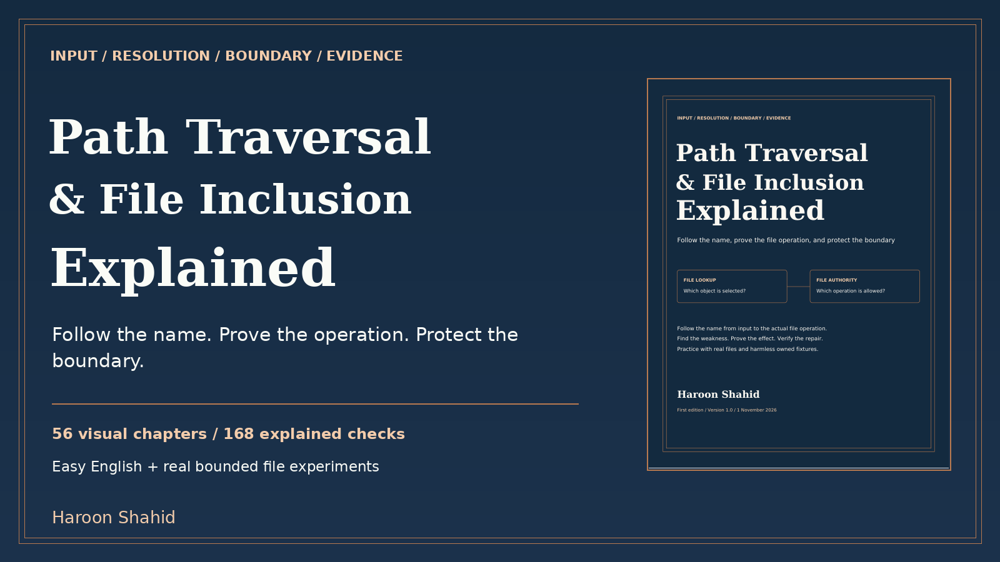

# Path Traversal & File Inclusion Explained - free preview

A visual learning kit by **Haroon Shahid** about file names, lookup, operation authority and defensible evidence.

[Read the free preview](Path_Traversal_and_File_Inclusion_Explained_Free_Preview.pdf)

The sample includes the introduction, learning roadmap and Chapters 1-3: files and names, web-to-file mapping, and relative/absolute starting points.

## Complete kit
- 168-page linked PDF and offline HTML, with 56 chapters.
- 168 explained checks and 129 original visual assets.
- 48 predictions, 36 guided missions and 28 synthetic worked cases.
- Optional Pathwright Python lab, evidence worksheets, recipes, contract atlas, glossary, index and primary sources.

The full ebook and practice kit will be available on Gumroad after launch.

The optional lab uses Python 3.11+ and free local port 8980. No third-party package installation is needed. Link and descriptor features depend on the host. It uses owned dummy files and fixed original Python fragments, not real secrets or arbitrary executable uploads. PHP, Windows filesystem and other integrations are review guidance. This is education, not certification or a guarantee of results.

The paid ebook, lab and publisher sources are not included in this public sample. The preview may be shared unchanged with attribution. For help or corrections, email gaknt19@gmail.com.
