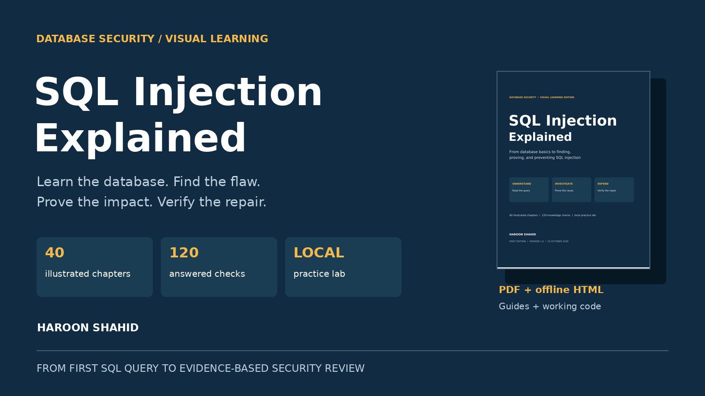

# SQL Injection Explained — Free Preview

Trace where user input becomes SQL syntax, then test whether the repair keeps query instructions separate from data.

## Read the free sample

The 16-page preview includes the introduction, learning roadmap, Chapters 1–3, and the complete injection lesson from Chapter 15, with answer explanations.

- [Open the preview PDF](./SQL_Injection_Explained_Free_Preview.pdf)

## Get the full learning kit

The full edition includes a 121-page PDF with 40 chapters, an offline HTML reading edition, and **Northstar Books** for optional local practice.

Practice materials include 120 answered checks, 18 SQL exercises, and 14 guided missions. The optional lab requires Node.js 24.12+ and a browser. Its core exercises use SQLite.

[Get SQL Injection Explained on Gumroad](https://haroonshahid.gumroad.com/l/sql-injection-explained)

The preview may be shared unchanged with attribution.

Written by Haroon Shahid. Prepared with AI assistance. For questions or corrections, email [gaknt2@gmail.com](mailto:gaknt2@gmail.com). [See all free previews](../README.md).
