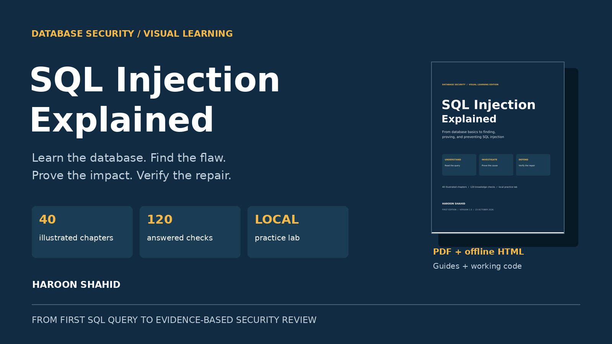

# SQL Injection Explained — Free Preview

A visual guide from database basics to finding, proving, and preventing SQL injection.

Published by **Haroon Shahid**.

An application can call `prepare()` and still be vulnerable if it already
concatenated untrusted text into its SQL. This book teaches the program/data
boundary behind that mistake, then connects evidence to a working repair.

## Read the free preview

[Download the preview PDF](SQL_Injection_Explained_Free_Preview.pdf)

It includes the introduction, foundation Chapters 1–3, and complete Chapter 15
as a sample injection lesson, plus their answer explanations. The full reading
sequence teaches Chapters 4–14 before Chapter 15. The practice app is not part
of this public preview.

## Get the complete package

[Full book and local practice kit](https://haroonshahid.gumroad.com/l/sql-injection-explained)

The full edition includes 40 illustrated chapters, 120 answered checks,
18 SQL exercises, 14 missions across 13 local rooms, revision sheets, and
a capstone with advanced review cases.

The lab uses fictional data and a compatible Node.js 24.12+ release. Core
exercises were checked with SQLite. Other server examples are documented
integration patterns; see the full package's validation report for scope.

## Responsible learning

Use the supplied local environment or systems you have explicit permission
to test. The book teaches understanding, controlled evidence, and defense.

The preview may be shared unchanged with attribution. It does not grant
permission to redistribute the paid ebook or customer package.

Version 1.0 · 23 October 2026 · Developed with AI assistance and executed checks.
