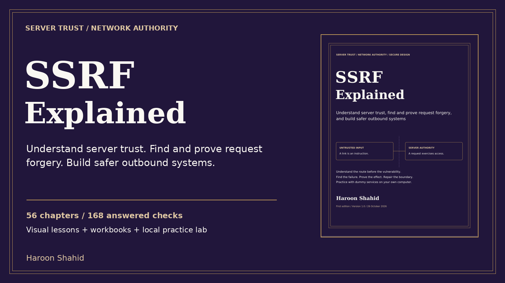

# SSRF Explained — free preview

A visual guide by **Haroon Shahid** to understanding server trust, finding and proving request forgery, and building safer outbound systems.

[Read the free preview](SSRF_Explained_Free_Preview.pdf)

The sample includes the introduction, learning roadmap and Chapters 1–3. It starts with the difference between browser and server requests, network reachability and DNS.

## The full learning kit

- 56 chapters; PDF and offline HTML reading editions.
- 112 original chapter and revision diagrams.
- 168 answered checks, 36 predictions, 24 worked review cases and 28 local missions.
- A fixed-loopback Node lab with dummy data, reversible actions and connection traces.
- Review templates, decision flows, implementation recipes, glossary and sources.

[Get the full ebook and practice kit](REPLACE_WITH_GUMROAD_URL)

The full paid publication is not included in this repository. The preview may be shared unchanged with attribution. Practice is for systems and destinations you own or are explicitly authorized to assess.

The lab uses real local HTTP, injected resolver changes and fictional metadata. Cloud, framework and multi-language guidance requires deployment-specific verification.
