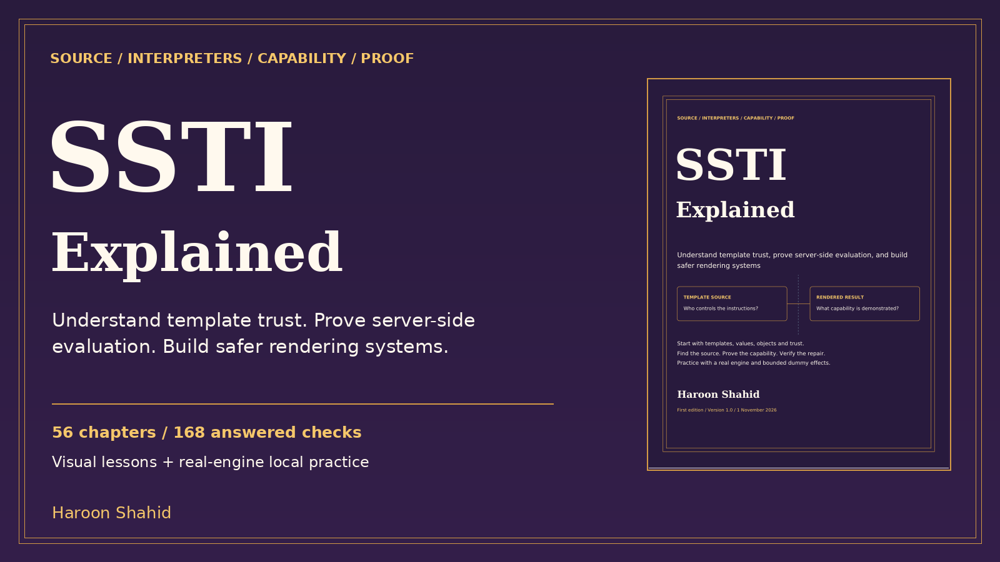

# SSTI Explained — Free Preview

Separate template source from user data and see what changes when a rendering engine treats input as instructions.

## Read the free sample

The 13-page preview includes the introduction, learning roadmap, and first three chapters.

- [Open the preview PDF](./SSTI_Explained_Free_Preview.pdf)

## Get the full learning kit

The full edition includes a 174-page PDF with 56 chapters, an offline HTML reading edition, and **Render Forge** for optional local practice.

Practice materials include 168 answered checks, 32 guided missions, and 24 worked cases. The optional lab uses Python 3.11+ and a browser, with dependencies bundled.

[Get SSTI Explained on Gumroad](https://haroonshahid.gumroad.com/l/ssti-explained)

The preview may be shared unchanged with attribution.

Written by Haroon Shahid. For questions or corrections, email [gaknt2@gmail.com](mailto:gaknt2@gmail.com). [See all free previews](../README.md).
