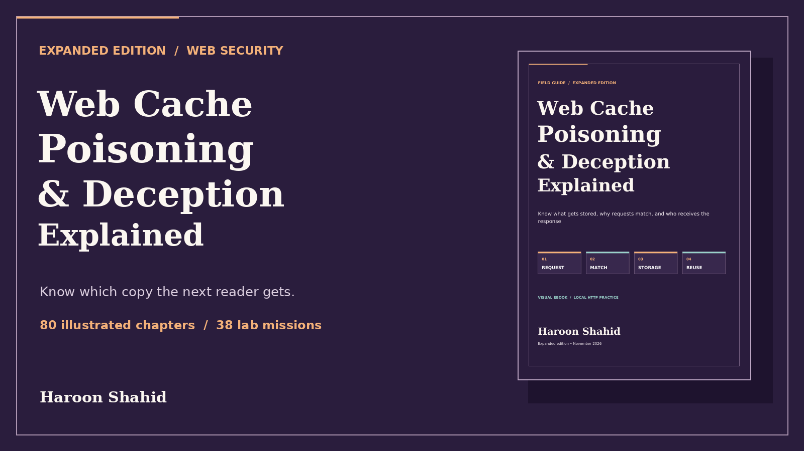

# Web Cache Poisoning & Deception Explained — Free Preview

Follow what a web cache stores, which requests reuse it, and when a response reaches the wrong reader.

## Read the free sample

The 7-page preview includes the introduction and first three chapters on caching, HTTP requests, and latency.

- [Open the preview PDF](./Web_Cache_Poisoning_and_Deception_Explained_Expanded_Free_Preview.pdf)

## Get the full learning kit

The full edition includes a 158-page PDF with 80 chapters, an offline HTML reading edition, and **Orchard Cache Observatory** for optional local practice.

Practice materials include 240 explained checks, 38 worked traces, and 38 local experiments. The optional lab runs on Python 3.11+ and a browser. It needs no third-party packages.

[Get Web Cache Poisoning & Deception Explained on Gumroad](https://haroonshahid.gumroad.com/l/web-cache-poisoning-and-deception-explained)

The preview may be shared unchanged with attribution.

Written by Haroon Shahid. For questions or corrections, email [gaknt2@gmail.com](mailto:gaknt2@gmail.com). [See all free previews](../README.md).
