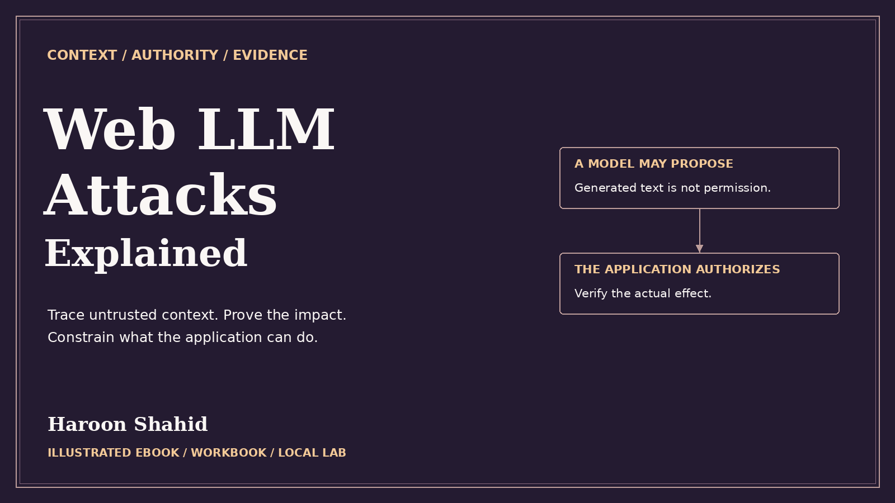

# Web LLM Attacks Explained — Free Preview

Trace untrusted context through retrieval, tool calls, and permission checks to a verified application effect.

## Read the free sample

The 14-page preview includes the introduction, learning roadmap, and first three chapters.

- [Open the preview PDF](./Web_LLM_Attacks_Explained_Free_Preview.pdf)
- [Offline HTML sample](./Web_LLM_Attacks_Explained_Free_Preview.html): select **Download raw file**, then open it in your browser.

## Get the full learning kit

The full edition includes a 150-page PDF with 56 chapters, an offline HTML reading edition, exercises, and **Boundary Desk** for optional local practice.

[Get Web LLM Attacks Explained on Gumroad](https://haroonshahid.gumroad.com/l/web-llm-attacks-explained)

Written by Haroon Shahid. For questions or corrections, email [gaknt2@gmail.com](mailto:gaknt2@gmail.com). [See all free previews](../README.md).
