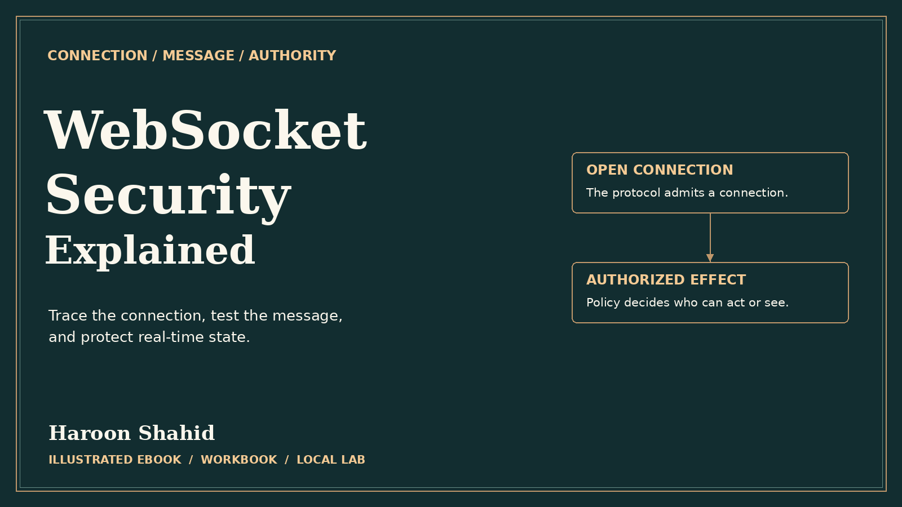

# WebSocket Security Explained — Free Preview

Follow a WebSocket connection through the handshake, message authorization, and who actually receives an update.

## Read the free sample

The 13-page preview includes the introduction, learning roadmap, and first three chapters.

- [Open the preview PDF](./WebSocket_Security_Explained_Free_Preview.pdf)
- [Offline HTML sample](./WebSocket_Security_Explained_Free_Preview.html): select **Download raw file**, then open it in your browser.

## Get the full learning kit

The full edition includes a 113-page PDF with 42 chapters, an offline HTML reading edition, exercises, and **Signal Yard Lab** for optional local practice.

The full edition is awaiting release. [Browse the available ebooks on Gumroad](https://haroonshahid.gumroad.com).

Written by Haroon Shahid. For questions or corrections, email [gaknt2@gmail.com](mailto:gaknt2@gmail.com). [See all free previews](../README.md).
