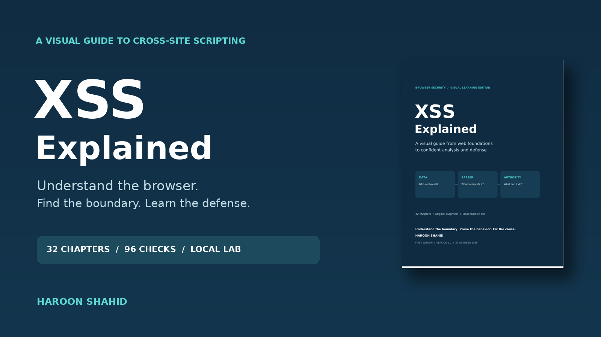

# XSS Explained — Free Preview

Follow untrusted input into the browser and see why the right defense depends on how the browser interprets it.

## Read the free sample

The 10-page preview includes the reading guide, learning roadmap, and first three chapters.

- [Open the preview PDF](./04-free-sample.pdf)

## Get the full learning kit

The full edition includes a 92-page PDF with 32 chapters, an offline HTML reading edition, and **XSS Explained Local Lab** for optional local practice.

Practice materials include 96 knowledge checks with explained answers and eight guided browser experiments. The optional lab uses Node.js and a desktop browser to compare vulnerable and safe examples.

[Get XSS Explained on Gumroad](https://haroonshahid.gumroad.com/l/xss-explained)

Written by Haroon Shahid. Prepared with AI assistance. For questions or corrections, email [gaknt2@gmail.com](mailto:gaknt2@gmail.com). [See all free previews](../README.md).
