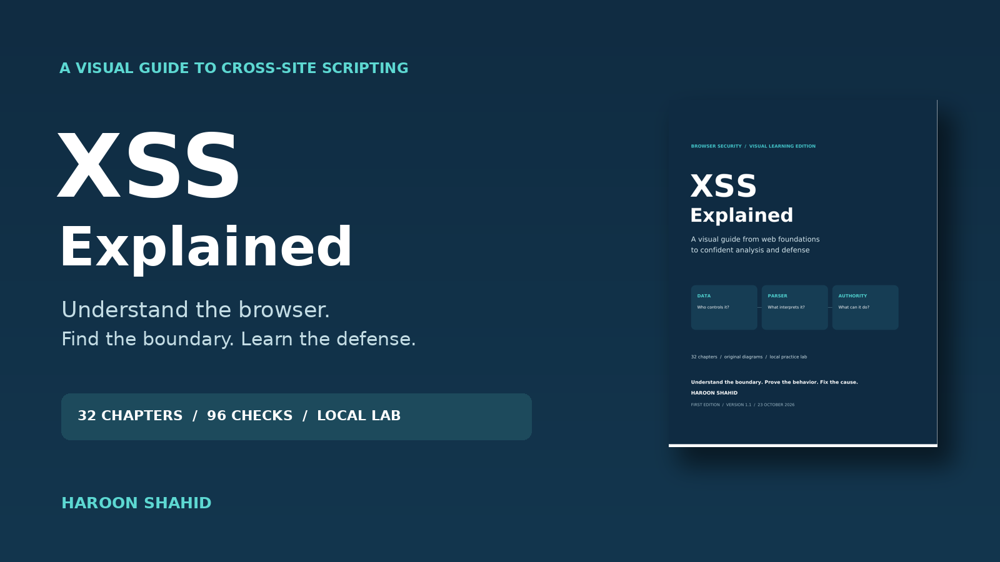

# XSS Explained

### A visual guide from web foundations to confident analysis and defense

Learn how Cross-Site Scripting happens, how browsers interpret input,
and how to choose the right defense.

Written in simple English, with diagrams, examples, and practical exercises.

## Read the free preview

Start with the introduction, learning roadmap, and first three chapters.

[Read the free sample PDF](04-free-sample.pdf)

## Get the complete ebook

[Get XSS Explained and the practice lab on Gumroad](https://haroonshahid.gumroad.com/l/xss-explained)

The complete package includes:

- A 92-page PDF ebook with 32 illustrated chapters.
- An offline HTML edition for reading in your browser.
- 96 knowledge checks with explained answers.
- Eight guided browser experiments.
- A local practice lab with vulnerable and safe examples.
- A capstone exercise and review rubric.
- A glossary, references, and revision diagrams.
- Setup instructions and troubleshooting help.

## Who is this for?

- Beginners learning web application security.
- Students who want clearer explanations of XSS.
- New security testers learning to follow data through an application.
- Developers learning safer ways to display user-controlled content.

## What will you learn?

- How HTTP, HTML, JavaScript, and the DOM connect.
- How cookies, sessions, and browser origins work.
- How reflected, stored, and DOM-based XSS happen.
- Why output context changes the correct defense.
- How encoding, validation, and sanitization differ.
- What CSP and Trusted Types protect.
- Where framework protections and raw HTML features need careful review.
- How to demonstrate a finding, explain its limits, and verify a repair.

## What do you need?

You can read the PDF without installing development tools.

The optional practice lab needs:

- A computer.
- A supported Node.js release.
- A browser.

The complete download is a ZIP file. Extract it and open
`00-START-HERE.html` for instructions.

Framework examples are teaching patterns rather than complete projects
for every framework. The core lab was browser-tested in Chromium on Linux;
other browser engines and the Windows launcher were not execution-tested
in that environment.

## About this repository

This repository contains the free preview and cover image.

The complete ebook and practice lab are available separately on Gumroad.

Published by **Haroon Shahid**. Prepared with AI assistance.

Practice only on systems you own or have permission to test.

For purchase support or corrections, reply to your Gumroad purchase receipt.
