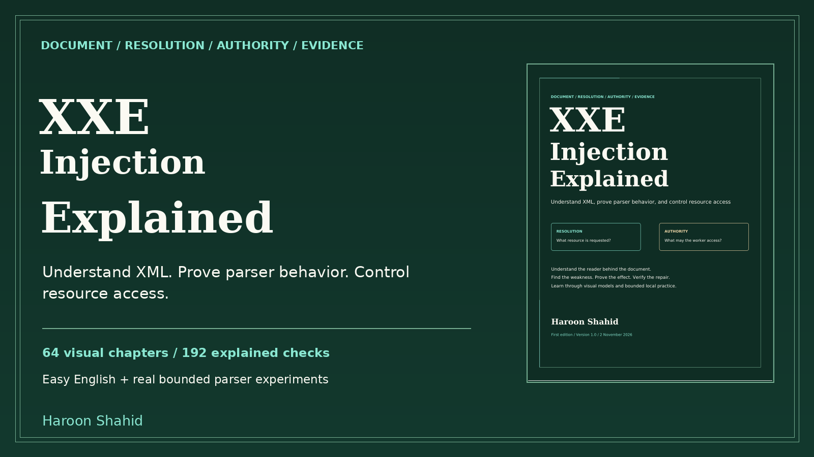

# XXE Injection Explained - free preview

A visual learning kit by **Haroon Shahid** about XML, parser behavior, resource access and secure document pipelines.

[Read the free preview](XXE_Injection_Explained_Free_Preview.pdf)

The sample contains the introduction, roadmap and Chapters 1-3: document authority, bytes/encodings, and XML syntax. No prior security knowledge is assumed.

## Complete learning kit
- 191-page linked PDF and offline HTML, with 64 illustrated chapters.
- 192 explained checks and 149 original SVG visual assets.
- 56 predictions, 40 guided missions and 32 worked synthetic cases.
- Optional Python standard-library lab and separate lxml bench.
- Parser passport, evidence/report templates, recipes, contract atlas, glossary, primary references and linked index.

[Get the full ebook and practice kit](https://haroonshahid.gumroad.com/l/xxe-injection-explained)

The core lab needs a current supported Python 3 release compatible with Python 3.11+, a browser and free local ports 8991-8992. Missions 33-40 need optional lxml. Experiments use finite original fixtures, dummy files and fixed loopback requests; they are not a general XML service or hostile-input sandbox. Other language, identity, converter and deployment integrations are review guidance. The included validation report names actual executed checks and limits.

This preview contains no paid chapters beyond the sample, no paid customer ZIP and no publisher sources. The preview may be shared unchanged with attribution. Education only; no certification or results guarantee. For help or corrections, email gaknt2@gmail.com.
